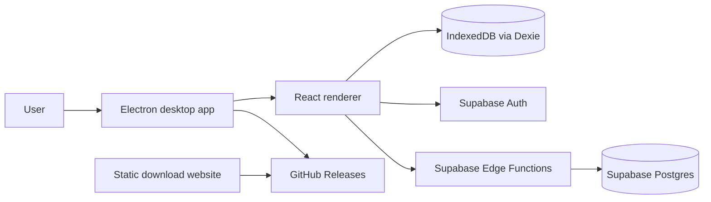

# Architecture

DailyCheck is intentionally small, but it uses the same moving parts as a real desktop application.

## Components

- `electron/`: main process, preload bridge, secure storage, native menus, updater integration.
- `src/`: React UI, recurrence logic, Dexie persistence, Supabase client, device client.
- `supabase/`: SQL migration and Edge Functions for device authorization.
- `website/`: static landing page that points to real GitHub Release assets after publication.
- `.github/workflows/`: CI and manual release packaging.

## Data Boundaries

Checklist tasks and completion history stay local in IndexedDB. Supabase stores identity and device metadata only. This keeps version 1 understandable and inexpensive while still teaching authentication and licensing-style server authorization.

## Desktop Security Defaults

The Electron window uses context isolation, no renderer Node integration, a narrow preload API, restricted navigation, and a Content Security Policy in `index.html`. The renderer cannot read arbitrary files or call unrestricted IPC.
